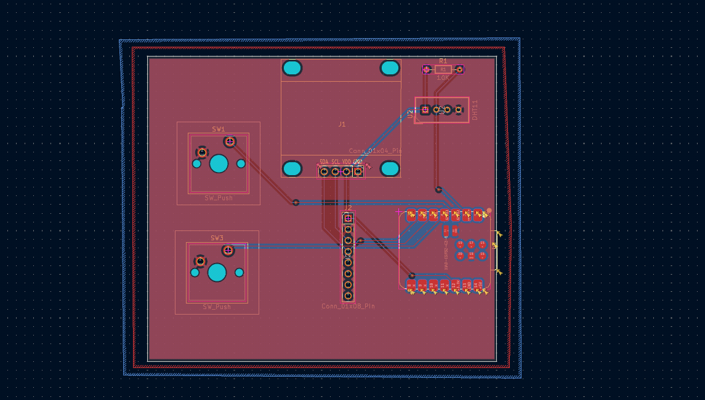

# Starbie

A small motion-controlled desk pet on a custom PCB. A XIAO ESP32-C3 draws a wandering pet on a 0.96" OLED, an MPU6050 reads tilt and shakes, a DHT11 reads temperature and humidity, and two buttons open a radial menu and a stats screen.

Built for Hack Club Half-Life, Week 1 (PCB design). Based on the [Week 1 example project by SharKingStudios](https://github.com/SharKingStudios/Starbie).

## How it works

| Control | What it does |
|---|---|
| Button 1, first press | Opens the radial menu |
| Tilt while the menu is open | Moves the selector ball toward NAP, PLAY, FEED or PET |
| Button 1, second press | Chooses the highlighted action |
| Button 2 | Shows or hides the stats screen (joy, energy, fullness, temperature, humidity) |
| Shake | Gives the pet a shake reaction |

## Parts

| Part | Reference |
|---|---|
| Seeed Studio XIAO ESP32-C3 | U1 |
| 0.96" 128x64 I2C OLED | J1 (4-pin header) |
| MPU6050 module (GY-521) | J2 (8-pin header) |
| DHT11 sensor | U2 |
| 10k resistor (pull-up on DHT11 data) | R1 |
| Push buttons (Cherry MX footprint) | SW1, SW3 |

## Bill of Materials

| Item | Qty | Supplier | Cost/item | Total Cost |
|---|---|---|---|---|
| [XIAO ESP32-C3 (bare, no headers)](https://www.or97.com/product/seeed-studio-xiao-esp32c3-risc-v-tiny-mcu-board-with-wi-fi-and-bluetooth5-0/) | 1 | OR97 | $14.44 | $14.44 |
| [0.96″ I2C OLED](https://digilog.pk/products/arduino-0-96-inch-iic-oled-display-128x64-i2c-ssd1306-lcd-screen-in-pakistan) | 1 | Digilog | $1.79 | $1.79 |
| [DHT11](https://digilog.pk/products/dht11-temperature-humidity-sensor-module-for-arduino) | 1 | Digilog | $1.00 | $1.00 |
| [10k resistor](https://digilog.pk/products/resistor-1-pack-of-15-value-10r-47r-100r-220r-330r-470r-1k-2-2k-4-7k-6-8k-10k-22k-47k-100k-220k-1) | 1 | Digilog | $1.00 | $1.00 |
| [2.54 mm male header strip](https://digilog.pk/products/gold-plated-2-54mm-male-40-pin-single-row-straight-round-pin-header-strip-in-pakistan) | 1 | Digilog | $0.50 | $0.50 |
| [MX-style mechanical switches](https://www.daraz.pk/catalog/?q=MX+mechanical+keyboard+switch) | 1 | Daraz | $1.00 | $1.00 |
| [Soldering iron](https://digilog.pk/products/variable-soldering-iron-093d) | 1 | Digilog | $3.79 | $3.79 |
| [0.8 mm 2.5 ft solder wire](https://digilog.pk/products/0-8mm-dia-2-5-ft-solder-wire-in-pakistan) | 1 | Digilog | $0.20 | $0.20 |
| Estimated total shipping | 1 | | | $6.00 |
| **Total** | | | | **$29.72** |

The same list is in [BOM.csv](BOM.csv).

## Wiring

| XIAO pin | GPIO | Net |
|---|---|---|
| D1 | 3 | DHT11_DATA |
| D2 | 4 | GPIO2 (button 1) |
| D3 | 5 | GPIO3 (button 2) |
| D4 | 6 | SCL (OLED and MPU6050) |
| D5 | 7 | SDA (OLED and MPU6050) |

The OLED and the MPU6050 share the same two I2C lines. The ground net is a copper pour on both layers.

## Firmware

`Starbie/Firmware/Starbie/Starbie.ino` is the example sketch from the guide with one change: because this board has SCL on D4 and SDA on D5, the I2C pins are set to `I2C_SDA_PIN = 7` and `I2C_SCL_PIN = 6`.

### Building it

1. Install Arduino IDE and add the ESP32 board package (esp32 by Espressif Systems).
2. Install the libraries: Adafruit GFX Library, Adafruit SSD1306, Adafruit MPU6050, DHT sensor library.
3. Select the board **XIAO_ESP32C3** and click **Verify/Compile**.

The sketch compiles (26% of program storage, 4% of dynamic memory). It has not been uploaded to hardware yet, because the board has not been built.

## Repository layout

| Path | Contents |
|---|---|
| `Starbie/` | KiCad project (`.kicad_pro`, `.kicad_sch`, `.kicad_pcb`) |
| `Starbie/Gerbers/` | Gerber and drill files for manufacturing |
| `Starbie/Firmware/Starbie/` | Arduino sketch |
| `Week 1 Care Package/` | Symbol and footprint libraries and 3D models used by the project |
| `BOM.csv` | Bill of materials with prices |
| `JOURNAL.md` | Build journal |

## Status

The PCB is designed and routed. The design rules check shows no unconnected items. The only 2 errors are "malformed courtyard" errors on the OLED footprint (J1) that come from the care package footprint.

## Screenshots

